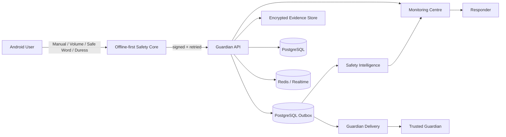

# Guardian competition architecture

## 15-second system view



## Safety boundary

```text
EXPLICIT SOS
   │
   ├── local storage
   ├── offline retry
   └── server incident
          │
          ├── Guardian notification
          ├── monitoring workflow
          ├── responder workflow
          └── intelligence enrichment

AI IS NOT IN THE "SHOULD SOS EXIST?" DECISION.
```

## Intelligence boundary

Guardian's current production intelligence is deterministic/explainable:
- confirmed incident facts;
- contributing/contradicting signals;
- risk level/confidence;
- recommendations;
- shadow comparison;
- search hints;
- human review.

Future neural/LLM/evidence models must be shadow-tested and cannot suppress explicit SOS.

## Reliability boundary

```text
Phone             API/DB             External services
-----             ------             -----------------
local save   ->   incident      ->    SMS / FCM / APNs
retry queue       durable outbox      object storage
evidence queue    audit/timeline      maps/geocoder
                  scheduler locks

External failure does not erase a locally saved SOS.
```

## Demo sequence

1. Start a TEST protected journey.
2. Trigger deliberate TEST SOS.
3. Show Incident Command.
4. Show explainable risk reasons.
5. Advance Trusted Guardian acknowledgement.
6. Dispatch/advance responder.
7. Show evidence/search/communications.
8. Resolve or explicitly close as false alarm.
9. Show audit/report metrics.

Use only TEST incidents and demo-safe contacts/providers.
